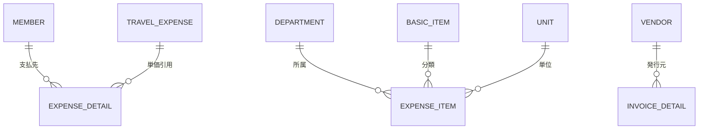

# AgriOS - マスタデータ詳細定義

## マスタデータの役割

システム運営の根幹となる各種マスタデータ。帳票の自動計算や入力補完のロジックを理解するためのリファレンス。

---

## 1. 名簿マスタ (`members`)

組合員や役員、アドバイザー等の基本情報を管理。**旅費計算の基準となる最重要マスタ**。

### フィールド定義

| フィールド | 型 | 必須 | 説明 |
|---|---|---|---|
| `name` | string | ○ | 氏名 |
| `furigana` | string | ○ | フリガナ（ソート・検索用） |
| `adminNo` | string | ○ | 管理番号（一意の識別子） |
| `positions` | array[string] | ○ | 役職配列（監事、理事、受入農家、アドバイザー等） |
| `distance` | number | ○ | **旅費計算の基準距離 (km)** |
| `carType` | string | ○ | 普通車 / 軽（高速料金判定用） |
| `bankAccount` | object | ○ | 振込先情報（下記参照） |
| `invoiceNo` | string | | インボイス登録番号 |

### bankAccount オブジェクト構造

```json
{
  "bank": "○○銀行",
  "branch": "△△支店",
  "type": "普通",
  "number": "1234567",
  "holder": "氏名"
}
```

### 実装例

```typescript
const member: Member = {
  name: "山田太郎",
  furigana: "ヤマダタロウ",
  adminNo: "M001",
  positions: ["理事", "受入農家"],
  distance: 45,          // 拠点から45km
  carType: "normal",
  bankAccount: {
    bank: "JA熊本",
    branch: "熊本支店",
    type: "savings",
    number: "1234567",
    holder: "ヤマダ タロウ"
  },
  invoiceNo: "T1234567890123"
};
```

---

## 2. 取引先マスタ (`vendors`)

請求書や納品書の発行元となる外部業者を管理。

| フィールド | 型 | 説明 |
|---|---|---|
| `name` | string | 取引先名称 |
| `code` | string | 取引先コード（請求システムで参照） |

---

## 3. 費目マスタ (`expenseItems`)

経費入力時の入力テンプレートとして機能。複合キーで一意性を管理。

| フィールド | 型 | 説明 |
|---|---|---|
| `managementNumber` | string | 管理番号 |
| `departmentId` | string | 所属部門ID（部門マスタ参照） |
| `basicItemId` | string | 基本項目ID（基本項目マスタ参照） |
| `description` | string | 摘要（小カテゴリ） |
| `amount` | number | 標準金額 |
| `unitId` | string | 単位ID（単位マスタ参照） |

### 実装例

```typescript
const expenseItem: ExpenseItem = {
  managementNumber: "E-001",
  departmentId: "DEPT-01",        // 青年部
  basicItemId: "ITEM-02",         // 旅費交通費
  description: "地域活動交通費",
  amount: 5000,
  unitId: "UNIT-KM"               // km単位
};
```

---

## 4. 旅費交通費マスタ (`travelExpenses`)

出張手当や交通費の単価設定、摘要の選択肢を管理。**経費明細の自動計算の基準データ**。

| フィールド | 型 | 説明 |
|---|---|---|
| `description` | string | 摘要（例：出張手当（日帰り）、交通費（自家用車）） |
| `amount` | number | **支給単価**（日当額や1kmあたりの金額等） |
| `remarks` | string | 補足説明（対象外条件等） |

### 実装例

```typescript
// 出張手当（日帰り）: 日額 5,000円
const travelExpense1 = {
  description: "出張手当（日帰り）",
  amount: 5000,
  remarks: "日帰り出張の場合のみ適用"
};

// 交通費（自家用車）: 1km あたり 22円
const travelExpense2 = {
  description: "交通費（自家用車）",
  amount: 22,
  remarks: "燃料代相当、領収書不要"
};
```

---

## 補助マスタ

### 部門マスタ (`departments`)

組織内の支部や班、プロジェクトチームを定義。

```typescript
interface Department {
  id: string;
  name: string;      // 例：青年部、女性部、営農技術班
  code: string;      // 例：DEPT-01
}
```

### 基本項目マスタ (`basicItems`)

会計上の「勘定科目」に近い中分類を定義。

```typescript
interface BasicItem {
  id: string;
  name: string;      // 例：旅費交通費、給料、消耗品費
}
```

### 単位マスタ (`units`)

数量の単位を定義。

```typescript
interface Unit {
  id: string;
  name: string;      // kg, 回, 日, 個, 式 等
}
```

---

## システム共通設定 (`commonSettings`)

システム全体の計算ロジックに影響を与える変数。

| キー | 説明 | デフォルト値 |
|---|---|---|
| `transport_rate` | 1kmあたりの交通費（円） | 22 |
| `withholding_rate` | 源泉徴収税率 | 0.1021 (10.21%) |
| `system_name` | 帳票に印字されるシステム名称 | AgriOS 熊有研 |

### 実装例

```typescript
const commonSettings = {
  transport_rate: 22,              // 1km = 22円
  withholding_rate: 0.1021,        // 10.21%
  system_name: "AgriOS 熊有研"
};
```

---

## マスタ間のリレーションシップ

### ERD (Entity Relationship Diagram)



### 参照関係の例

1. **経費明細入力時**:
   - 組合員を選択 → `members` から `distance` を取得
   - 旅費マスタを選択 → `travelExpenses` から `amount` を取得
   - 計算式: `payment = distance × amount (km単価の場合)`

2. **レポート生成時**:
   - `expenseDetails` の `memberId` から `members` を参照
   - `bankAccount` をスナップショット保存

---

## マスタメンテナンスのポイント

### 更新頻度
- **会員**: 年1〜2回（人事異動時）
- **部門**: 組織変更時
- **旅費交通費**: 年1回（単価改定時）
- **共通設定**: 年1回（源泉徴収税率変更等）

### 不変性の担保
- レポート発行時に、当時の情報を `*Snapshot` フィールドに保存
- マスタ更新後も過去帳票は変化しない
- 監査証跡としての信頼性を確保

### バリデーション
- 管理番号は一意制約
- distance は正の数値のみ
- bankAccount は完全に入力されているか確認

---
## 関連ドキュメント

- [[../DataModel/03-Data-Model|データモデル]] - データモデル全体
- [[../BusinessLogic/05-Business-Logic|ビジネスロジック]] - 計算ロジック・ビジネスルール
- [[../_Index|ナレッジベース索引]] - 全体INDEX
