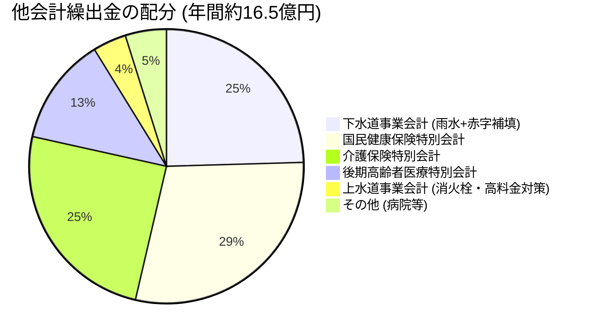

# 他会計繰出金・公費補填の実態

一般会計（税金）から特別会計および企業会計に対して毎年支出されている「他会計繰出金（約16.5億円）」の実態と、市民1世帯あたりの隠れた負担を明らかにします。

## 💸 繰出金の内訳（年間約16.5億円）

- **市民1世帯（約16,000世帯）あたりの年間負担額**: **約10万3,000円**
- 住民税や固定資産税として納めた税金のうち、世帯あたり毎月8,600円が特別会計・インフラ赤字の穴埋めに消えています。

---

## 🚨 なぜ繰出金が問題なのか？

### 1. 独立採算原則の形骸化（下水道事業）
下水道事業は本来、利用者が支払う使用料で維持管理費を賄う「独立採算制（地方公営企業法）」が原則です。
しかし、宇土市の下水道は経費回収率が **62.1%** にとどまり、**年間4.05億円** が一般会計から補填されています。
- 下水道を使っていない地区（浄化槽地域）の住民も、一般財源（市民税・固定資産税）を通じて下水道の赤字補填を負担させられているという「地域間不公平」が生じています。

### 2. 医療・介護給付の高齢化圧力
- 国民健康保険および介護保険への法定外繰出（赤字補填）は、被保険者の高齢化と低所得者比率の高さから削減が極めて困難です。
- この法定外繰出を漫然と続けると、一般会計の子育て支援や学校教育、道路整備などの予算枠を直接圧迫します。

---

## 💡 議会・政策判断のポイント
> [!tip] 議員・政策担当者のアクション
> 1. 下水道事業の繰出金のうち「雨水公費負担分（基準内）」と「汚水赤字補填分（基準外・赤字補填）」を厳密に峻別し、基準外繰出の縮減計画を策定させる。
> 2. 下水道料金の適正化（値上げによる独立採算化）により浮いた一般財源を、全市民が享受できる「小中学校給食費無償化（年間約1.5億円）」などの子育て支援に振り向ける政策パッケージを提示する。

---
## 関連ノート
- [[宇土市_財政構造診断_総括]]
- [[下水道事業会計_年間4億円補填と独立採算の危機 (R7決算)]]
- [[スマートシュリンク戦略ビジョン_5大政策ピラー]]
- [[01_財政・公会計_MOC]]
