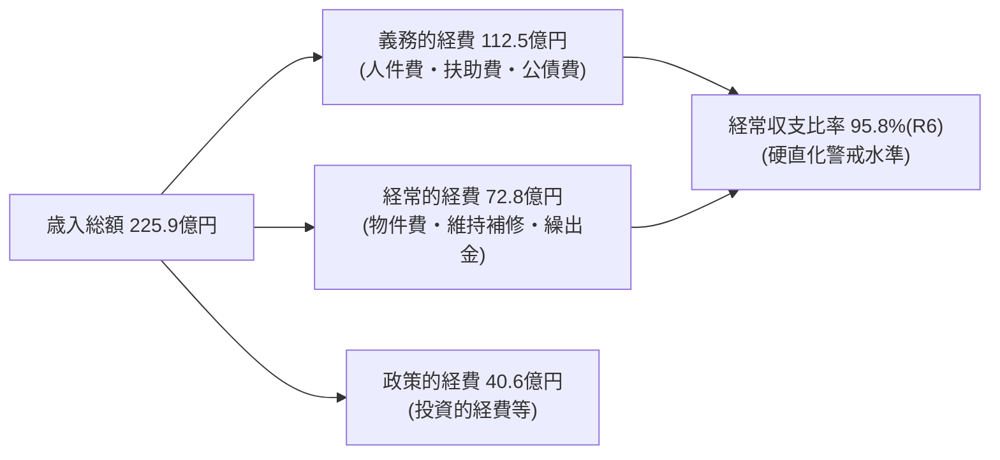

# 宇土市 財政構造診断 総括

> [!abstract] 一言で言えば
> **「震災からの復旧フェーズは終了。しかし経常収支比率95.8%（R6）の高止まりと年間約16.5億円の他会計繰出が、将来の投資余力を奪っている。」**

> 📌 **数値の正本**: [[civic/election-2026/current-values#💰 財政（★ 主要指標 基準値：出典・年度つき）|現状値データ集（正本）]] に統一。経常収支比率は **R5=94.2% → R6=95.8%**（悪化）。財政調整基金は **R6末35.59億 → R7末30.36億**（取崩しで減）。

## 1. 財務基礎データ（最新 R6決算カード）
- **歳入総額**: 225億9,112万円
- **歳出総額**: 219億9,274万円
- **形式収支**: 5億9,838万円の黒字
- **実質収支**: 2,498万円の黒字（前年度からの繰越財源等を精算後）
- **単年度実質収支**: ▲6億7,075万円（実質的な単年度赤字基調）
- **積立金残高（基金合計）**: 71億1,782万円
  - 財政調整基金: 35億5,900万円
  - 減債基金: 6億5,200万円
  - 市有施設整備基金: 16億2,200万円
  - 庁舎建設等基金: 6億6,200万円
  - その他特定目的基金: 6億2,282万円
- **地方債現在高**: 213億3,387万円

---

## 2. 財政の三大構造課題

### ① 経常収支比率の高止まり（R6=95.8%）
経常収支比率は **R6決算で95.8%**（R5は94.2%から悪化）と、警戒ライン（90%超）を上回り続けています。
- 人件費（32.4億円）、扶助費（55.9億円）、公債費（24.1億円）の義務的経費が一般財源の過半を占めています。
- 扶助費は高齢化と障がい福祉、子育て支援の拡充により、年率2〜3%のペースで自然増が続いています。

### ② 熊本地震復興債の元金償還ピーク（公債費24.1億円）
- 平成28年熊本地震による市庁舎被災・インフラ復旧のために発行した震災関連債の償還がピークを迎えています。
- 実質公債費比率は **12.0%**。早期健全化基準（25%）や起債制限基準（18%）は大きく下回っているものの、財政を圧迫する主要因です。
- 詳細は [[公債費償還カーブと復旧債ピーク分析]] を参照。

### ③ 他会計への巨額繰出（年16.5億円）
- 国民健康保険、介護保険、後期高齢者医療の各特別会計、および上水道・下水道の企業会計に対し、一般会計から年間16.5億円もの税金が補填されています。
- 詳細は [[他会計繰出金・公費補填の実態]] を参照。

---

## 💡 議会・政策判断のポイント
> [!tip] 議員・政策担当者のアクション
> 1. 単年度実質収支がマイナス6.7億円となっている構造要因（基金取崩しによる投資的事業充当）を精査する。
> 2. [[スマートシュリンク戦略ビジョン_5大政策ピラー]] に基づき、他会計繰出金の適正化と固定費の削減（延床面積20%縮減）をセットで推進する。

---
## 関連ノート
- [[01_財政・公会計_MOC]]
- [[決算カード9か年推移分析 (H28-R6)]]
- [[公債費償還カーブと復旧債ピーク分析]]
- [[基金耐久力と積立・取崩し戦略]]
- [[他会計繰出金・公費補填の実態]]
- [[健全化判断比率と資金不足比率の推移 (R7審査)]]
