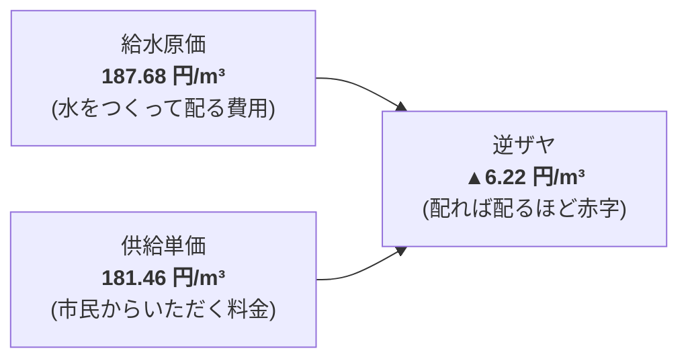

# 上水道事業会計 本業赤字と逆ザヤ分析 (R7決算)

宇土市の上水道事業における「給水原価割れ（逆ザヤ）」、漏水による「有収率84.5%」の低迷、および将来の管路更新に向けた経営危機の実態分析です。

## 💧 逆ザヤの構造（1m³あたり▲6.22円）

- **年間有収水量**: 3,923,780 m³
- **年間本業赤字額（純粋な給水逆ザヤ分）**:
  `3,923,780 m³ × ▲6.22円 = ▲2,440万円/年`
- 受託工事収益や一般会計繰入金等で帳簿上の最終損益は均衡を保っているものの、**「水事業そのものは構造的赤字」** に陥っています。

---

## 🚰 有収率84.5%（年間約72万トンの水漏れ）
- **総配水量**: 4,643,526 m³
- **有収水量**: 3,923,780 m³
- **無収水量（漏水等）**: **719,746 m³（無収率 15.5%）**

> [!warning] 漏水放置のコスト
> 年間72万トン（25mプール約1,400杯分）の水道水が地下で漏水しています。
> 汲み上げ・浄水のための電気代・薬品代を投じた水が売上に寄与せず消えており、電気料金高騰下で経営を直撃しています。

---

## 🛠️ 管路老朽化と40年超過率
- **水道管路総延長**: 約382 km
- **法定耐用年数（40年）超過管路**: **約24.8%**（約95 kmが老朽化）
- **現在の年間更新率**: **約0.7%/年**（すべて更新するのに約140年かかるペース）

---

## 💡 議会・政策判断のポイント
> [!tip] 議員・政策担当者のアクション
> 1. 単なる「水道料金値上げ」には市民の強い反発が予想されるため、まず「AI音響センサー等を用いた漏水調査による有収率向上（84.5%→90%へ改善＝年間約2,000万円の改善）」を先行させる方針を求めること。
> 2. 料金改定を行う場合は、低所得者や多子世帯への生活防衛減免措置とセットで議論すること。

---
## 関連ノート
- [[上下水道40年更新需要と料金改定ロードマップ]]
- [[下水道事業会計_年間4億円補填と独立採算の危機 (R7決算)]]
- [[自治体経営KPIハンドブック_定義と市民翻訳]]
- [[02_公共施設・インフラ経営_MOC]]
