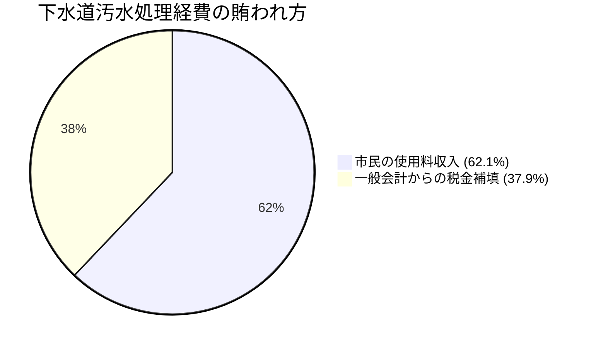

# 下水道事業会計 年間4億円補填と独立採算の危機 (R7決算)

宇土市の公共下水道事業および特定環境保全・漁業集落排水事業における「経費回収率62.1%」の危機と、一般会計からの年間4.05億円補填の持続可能性を検証します。

## 🚽 汚水分経費回収率の現状

- **汚水処理総経費**: 約10億6,800万円
- **下水道使用料収入**: 約6億6,300万円
- **経費回収率**: **62.1%**（国が求める自立基準 100%に遠く及ばず）
- **一般会計繰入金（雨水公費分＋赤字補填）**: **4億0,500万円/年**

---

## ⚓ 漁業集落排水の壊滅的回収率（10.4%）
特に深刻なのが、走潟・網田地区等の漁業集落排水事業です。
- **経費回収率**: **わずか 10.4%**
- 維持管理費の約9割を一般会計からの公費補填に依存しており、実質的に公費依存のインフラとなっています。
- 加入戸数の減少と高齢化に伴い、今後さらに回収率が悪化する見通しです。

---

## ⚠️ 地域間不公平の解消という政治課題
宇土市全域で下水道が整備されているわけではありません。
- **下水道整備区域の市民**: 下水道を使用し、不足分（年間約4億円）を税金で補填してもらっている。
- **浄化槽区域の市民**: 自己負担で浄化槽を設置・維持管理しつつ、払った税金が下水道地域の赤字補填に使われている。

この「見えない地域間格差」は、今後の財政改革において避けて通れない議会論点です。

---

## 💡 議会・政策判断のポイント
> [!tip] 議員・政策担当者のアクション
> 1. 漁業集落排水地域について、大規模更新時期を迎えた段階で「個別合併処理浄化槽への転換」を検討するロードマップの策定を提言する。
> 2. 下水道使用料の段階的見直しと、汚水処理原価の徹底した情報公開を求めること。

---
## 関連ノート
- [[上水道事業会計_本業赤字と逆ザヤ分析 (R7決算)]]
- [[他会計繰出金・公費補填の実態]]
- [[上下水道40年更新需要と料金改定ロードマップ]]
- [[02_公共施設・インフラ経営_MOC]]
