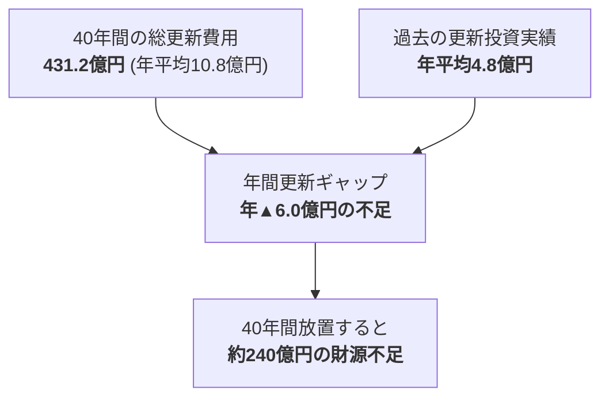

# 公共施設431億円問題と年間15.5億円ギャップ

宇土市が保有する全公共施設（延床面積 約14.3万m²）を今後40年間維持・更新した場合に発生する総費用と、現状の財源見通しとの間に横たわる「年間更新ギャップ」の構造分析です。

## 💥 431億円問題の構造

- **延床面積総計**: 143,280 m²
- **1m²あたりの平均更新単価**: 301,000円/m²
- **今後40年間の更新需要**: **431億2,728万円**
- **年間必要額**: **10億7,818万円/年**
- **近年の公共施設維持更新実績**: 約4.8億円/年
- **年間不足額（ギャップ）**: **▲5億9,818万円/年（約6億円不足）**

---

## 🏫 用途別の延床面積と更新需要シェア
1. **学校教育系施設（小中学校・幼稚園）**:
   - 延床面積: 61,610 m²（**全体の43.0%**）
   - 40年更新費用: **約185.4億円**
   - 課題: 児童生徒数の減少（2050年までに年少人口▲41.4%）に対して学校面積が過大。
2. **市民文化・集会施設（公民館・市民会館）**:
   - 延床面積: 24,350 m²（**全体の17.0%**）
   - 40年更新費用: **約73.3億円**
   - 課題: 各地区の公民館が築35〜45年を迎えており、一斉更新期が到来。
3. **スポーツ・レクリエーション施設（体育館・武道館等）**:
   - 延床面積: 21,500 m²（**全体の15.0%**）
   - 40年更新費用: **約64.7億円**
4. **行政系施設・その他（庁舎・消防・福祉）**:
   - 延床面積: 35,820 m²（**全体の25.0%**）
   - 40年更新費用: **約107.8億円**
   - ※新庁舎は完成済みだが、旧支所や周辺関連施設の老朽化が進行。

---

## 🛡️ 解決策：公共施設延床面積20%縮減シナリオ
すべての施設を建て替えることは不可能です。
- **目標**: 2040年までに公共施設延床面積を **20%縮減（▲28,656 m²）**。
- **削減効果**:
  - 40年間の更新費用を **約86.2億円削減**。
  - 年間更新ギャップを **▲6.0億円から▲3.8億円へ圧縮**。
  - 維持管理光熱費を年間約1.2億円削減。

---

## 💡 議会・政策判断のポイント
> [!tip] 議員・政策担当者のアクション
> - 施設更新の陳情に対して「個別建て替え」を約束せず、「[[スマートシュリンク戦略ビジョン_5大政策ピラー]]（学校と公民館・避難所の多世代複合化）」を前提とした集約案を地域に提示すること。

---
## 関連ノート
- [[公共施設用途別老朽度と集約・複合化方針]]
- [[スマートシュリンク戦略ビジョン_5大政策ピラー]]
- [[2040未来予測センター_時間軸と判断期限]]
- [[02_公共施設・インフラ経営_MOC]]
