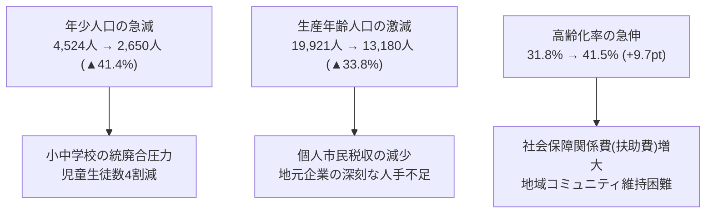

# 宇土市 人口動態と将来推計 (2025-2050)

> 🔗 **議員活動との接続**: 全政策の前提となる構造的課題 → [[civic/concepts/population-decline|人口減少]] / [[civic/election-2026/candidates/hijikuro-koji/city-vision-principles|まちづくり理念（人口が減っても、暮らしの豊かさは減らさない）]]

国立社会保障・人口問題研究所（社人研）推計および宇土市住民基本台帳データに基づく、2025年から2050年までの人口規模・年齢3区分別人口の推移分析です。

## 📉 人口規模と年齢構成の推移

| 年次 | 総人口 | 年少人口 (0-14歳) | 生産年齢 (15-64歳) | 老年人口 (65歳以上) | 高齢化率 |
| :--- | :---: | :---: | :---: | :---: | :---: |
| **2020年 (実績)** | 36,276人 | 4,821人 (13.3%) | 20,412人 (56.3%) | 11,043人 (30.4%) | 30.4% |
| **2025年 (推計)** | 35,845人 | 4,524人 (12.6%) | 19,921人 (55.6%) | 11,400人 (31.8%) | 31.8% |
| **2030年 (推計)** | 34,250人 | 3,980人 (11.6%) | 18,740人 (54.7%) | 11,530人 (33.7%) | 33.7% |
| **2035年 (推計)** | 32,510人 | 3,450人 (10.6%) | 17,210人 (52.9%) | 11,850人 (36.4%) | 36.4% |
| **2040年 (推計)** | **30,698人** | **3,080人 (10.0%)** | **15,890人 (51.8%)** | **11,728人 (38.2%)** | **38.2%** |
| **2050年 (推計)** | **27,046人** | **2,650人 (9.8%)** | **13,180人 (48.7%)** | **11,216人 (41.5%)** | **41.5%** |

---

## 🔍 主要な構造変化のポイント

1. **生産年齢人口（稼ぎ手）の3割減**:
   - 2025年の約2.0万人から2050年には約1.3万人へ減少。税収基盤の縮小が避けられません。
2. **年少人口の4割減と学校再編**:
   - 2050年には市全体で子どもの数が約2,650人まで減少。小中学校の統廃合・小中一貫校化は待ったなしの状況となります。
3. **85歳以上超高齢層の増加**:
   - 65歳以上人口の絶対数は2035年頃にピークを迎えますが、85歳以上の単身高齢者・認知症高齢者は2045年にかけて増加し続けます。

---

## 💡 議会・政策判断のポイント
> [!tip] 議員・政策担当者のアクション
> - 「人口減少を食い止める」というスローガンだけでなく、「人口が2.7万人になっても持続可能で住民満足度が高い都市構造（スマートシュリンク）」への政策シフトを訴えること。

---
## 関連ノート
- [[2040未来予測センター_時間軸と判断期限]]
- [[スマートシュリンク戦略ビジョン_5大政策ピラー]]
- [[市内7地区カルテ_宇土地区 (中心市街地・生活拠点)]]
- [[RMO_地域運営組織と住民主体自治モデル]]
- [[03_人口・地域社会_MOC]]
