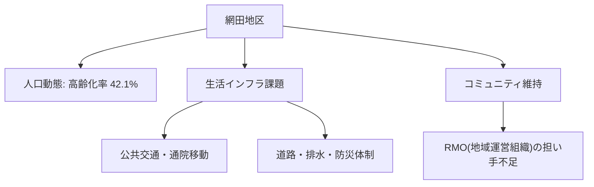

# 市内7地区カルテ：網田地区（沿岸・観光・医療交通）

宇土市内7地区における人口動態、高齢化率、地域インフラ、課題および将来の地域社会ビジョンです。

## 📍 地区基本データ
- **地区人口**: **3,800人**
- **高齢化率**: **42.1%**
- **地域特性**: 御輿来海岸（おこしきかいがん）などの観光資源を有する沿岸部。JR網田駅を有すが、路線バス減便と医療機関へのアクセスが深刻。

---

## 🔍 地域インフラと生活課題

---

## 💡 政策処方箋・重点アクション
> [!tip] 地域づくりのアクション
> **観光振興（DMO）と地域商社化、沿岸部デマンド交通運行、網田診療所の維持支援。**
> - 地域づくり協議会と行政の協働による [[RMO_地域運営組織と住民主体自治モデル]] の確立が急務です。

---
## 関連ノート
- [[03_人口・地域社会_MOC]]
- [[宇土市_人口動態と将来推計 (2025-2050)]]
- [[RMO_地域運営組織と住民主体自治モデル]]
- [[スマートシュリンク戦略ビジョン_5大政策ピラー]]
