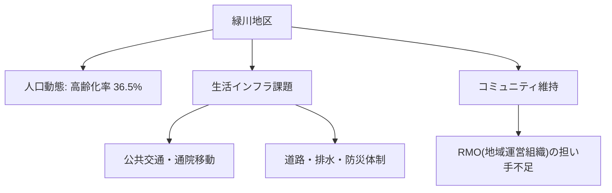

# 市内7地区カルテ：緑川地区（農地・河川・防災）

宇土市内7地区における人口動態、高齢化率、地域インフラ、課題および将来の地域社会ビジョンです。

## 📍 地区基本データ
- **地区人口**: **2,900人**
- **高齢化率**: **36.5%**
- **地域特性**: 緑川河口部に位置する農業地帯。水害リスク（河川氾濫・高潮）が高く、避難路確保と水門管理の省人化が重要。

---

## 🔍 地域インフラと生活課題

---

## 💡 政策処方箋・重点アクション
> [!tip] 地域づくりのアクション
> **流域治水プロジェクト推進、農業排水路の老朽化対策、スマート防災ネットワーク構築。**
> - 地域づくり協議会と行政の協働による [[RMO_地域運営組織と住民主体自治モデル]] の確立が急務です。

---
## 関連ノート
- [[03_人口・地域社会_MOC]]
- [[宇土市_人口動態と将来推計 (2025-2050)]]
- [[RMO_地域運営組織と住民主体自治モデル]]
- [[スマートシュリンク戦略ビジョン_5大政策ピラー]]
