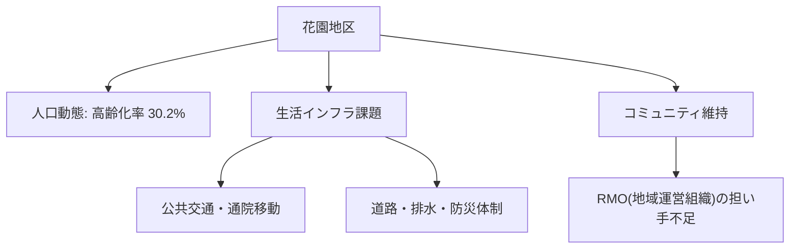

# 市内7地区カルテ：花園地区（学校・住宅・田園）

宇土市内7地区における人口動態、高齢化率、地域インフラ、課題および将来の地域社会ビジョンです。

## 📍 地区基本データ
- **地区人口**: **6,200人**
- **高齢化率**: **30.2%**
- **地域特性**: 花園小学校を中心に住宅地と田園が広がる。熊本都市圏への通勤利便性が高い一方、幹線道路沿いの交通安全対策が求められる。

---

## 🔍 地域インフラと生活課題

---

## 💡 政策処方箋・重点アクション
> [!tip] 地域づくりのアクション
> **通学路安全確保、若者向け戸建て住宅誘導、農業基盤整備。**
> - 地域づくり協議会と行政の協働による [[RMO_地域運営組織と住民主体自治モデル]] の確立が急務です。

---
## 関連ノート
- [[03_人口・地域社会_MOC]]
- [[宇土市_人口動態と将来推計 (2025-2050)]]
- [[RMO_地域運営組織と住民主体自治モデル]]
- [[スマートシュリンク戦略ビジョン_5大政策ピラー]]
