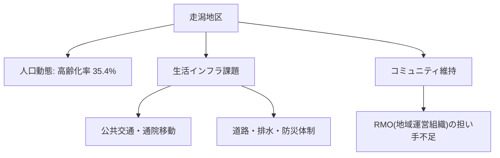

# 市内7地区カルテ：走潟地区（漁業・海苔・コミュニティ）

> 🔗 **議員活動との接続**: 走潟は宇土市初の地区防災計画モデル地区。土黒功司の実績・公約①「守る」の原点 → [[06_市政・議会/02_選挙2026/candidates/hijikuro-koji/1期目の成果|1期目 実績棚卸し]] / [[06_市政・議会/02_選挙2026/candidates/hijikuro-koji/5つの課題-content|5つの挑戦 肉付け]]

宇土市内7地区における人口動態、高齢化率、地域インフラ、課題および将来の地域社会ビジョンです。

## 📍 地区基本データ
- **地区人口**: **2,545人**
- **高齢化率**: **35.4%**
- **地域特性**: 有明海苔の主要生産地であり漁業集落排水を利用。漁業者後継者不足と漁排会計の低回収率（10.4%）が課題。

---

## 🔍 地域インフラと生活課題

---

## 💡 政策処方箋・重点アクション
> [!tip] 地域づくりのアクション
> **海苔養殖の高付加価値化・ブランド化、漁業集落排水の維持管理合理化。**
> - 地域づくり協議会と行政の協働による [[RMO_地域運営組織と住民主体自治モデル]] の確立が急務です。

---
## 関連ノート
- [[03_人口・地域社会_MOC]]
- [[宇土市_人口動態と将来推計 (2025-2050)]]
- [[RMO_地域運営組織と住民主体自治モデル]]
- [[スマートシュリンク戦略ビジョン_5大政策ピラー]]
