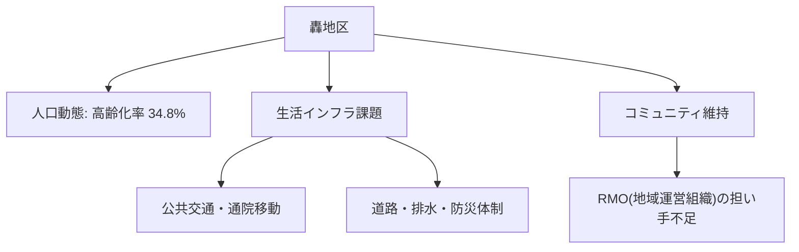

# 市内7地区カルテ：轟地区（名水・歴史・コミュニティ）

宇土市内7地区における人口動態、高齢化率、地域インフラ、課題および将来の地域社会ビジョンです。

## 📍 地区基本データ
- **地区人口**: **3,100人**
- **高齢化率**: **34.8%**
- **地域特性**: 日本名水百選「轟水源」を擁し、歴史と自然が豊かな地域。コミュニティの結束は強いが高齢化が進行。

---

## 🔍 地域インフラと生活課題

---

## 💡 政策処方箋・重点アクション
> [!tip] 地域づくりのアクション
> **轟水源の観光・環境保全、歴史遺産の地域資源化、地域運営組織(RMO)の先進モデル化。**
> - 地域づくり協議会と行政の協働による [[RMO_地域運営組織と住民主体自治モデル]] の確立が急務です。

---
## 関連ノート
- [[03_人口・地域社会_MOC]]
- [[宇土市_人口動態と将来推計 (2025-2050)]]
- [[RMO_地域運営組織と住民主体自治モデル]]
- [[スマートシュリンク戦略ビジョン_5大政策ピラー]]
