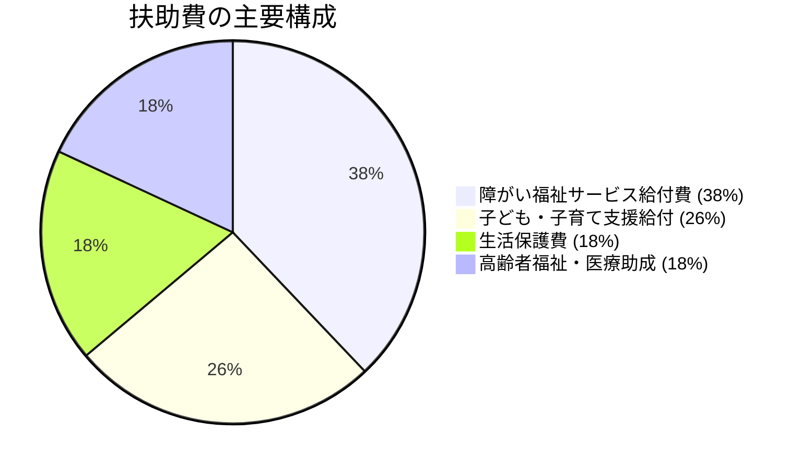

# 福祉・子育て・教育 くらしのセーフティネット

> 🔗 **議員活動との接続**: 公約②「育てる」の裏付け（GIGA・サードプレイス・こどもまんなか） → [[06_市政・議会/themes/childcare-education|子育て・教育・人材育成]] / [[06_市政・議会/02_選挙2026/candidates/hijikuro-koji/5つの課題-content|5つの挑戦 肉付け]]

宇土市の歳出において最大のシェア（55.9億円）を占める「扶助費」の内訳分析と、人口減少下でも揺るがない子育て・教育環境を維持するための持続可能モデルです。

## 📈 扶助費55.9億円の内訳と自然増要因

- **年平均自然増率**: **+2.5%〜+3.0%/年**（年間約1.4億円の自動増）
- 障がい福祉サービス利用者数の増加、および放課後等デイサービスの利用増が主要な押し上げ要因となっています。

---

## 👶 子育て・教育の持続可能性パッケージ

### 1. 学校給食費の無償化（年間約1.5億円）
- 子育て世帯の経済的負担軽減策として最も要望が高い施策。
- **財源論**: 単なる一般財源の持ち出しではなく、[[他会計繰出金・公費補填の実態]]（下水道赤字補填の是正）や公共施設床面積縮減で捻出した財源を充当する「政策トレードオフ」を明確にする。

### 2. 小中一貫教育・コミュニティスクール
- 児童生徒数減少に伴う複式学級化を防ぎ、専門教科担任制や手厚い部活動を維持するため、中学校区を単位とした小中一貫教育を推進。

### 3. 放課後児童クラブ（学童）の待機児童ゼロ
- 共働き世帯の必須インフラとして、学校敷地内の余裕教室を活用した学童保育の受け入れ枠拡大。

---

## 💡 議会・政策判断のポイント
> [!tip] 議員・政策担当者のアクション
> - 「子育て支援拡充」を訴える際は必ず「どの既存事業・インフラ維持費を削って財源を捻出するか」の裏付けをセットで提示することで、無責任なバラマキ批判を封じ、建設的な政策議論を主導すること。

---
## 関連ノート
- [[宇土市_財政構造診断_総括]]
- [[他会計繰出金・公費補填の実態]]
- [[スマートシュリンク戦略ビジョン_5大政策ピラー]]
- [[03_人口・地域社会_MOC]]
