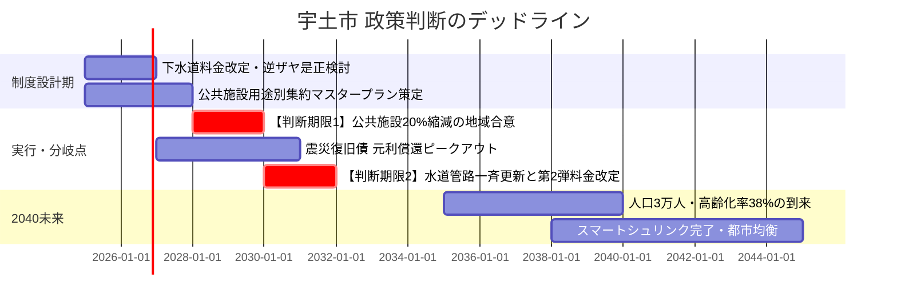

# 2040未来予測センター：時間軸と判断期限

2025年から2040年にかけて宇土市を襲う「人口減少」「インフラ更新集中」「財政硬直化」の複合危機と、引き返せなくなる前の「政策判断デッドライン」のタイムラインです。

## ⏳ 政策タイムライン（2025〜2040）

---

## 🚨 2大「判断期限（デッドライン）」

### ① 2028年：公共施設20%縮減の地域合意
- 築40年超を迎える公民館・学校・体育館の一斉更新期が2030年代初頭に到来します。
- この時期を過ぎると、「壊れたから場当たり的に改修する」負の連鎖に陥り、[[公共施設431億円問題と年間15.5億円ギャップ]] を回避できなくなります。

### ② 2030年：上下水道事業の自立化判断
- 管路法定耐用年数超過率が30%を突破。
- 一般会計からの赤字補填に頼り続けるか、独立採算制を確立して将来世代にインフラを残すかの最後の分岐点です。

---

## 💡 議会・政策判断のポイント
> [!tip] 議員・政策担当者のアクション
> - 「先送り」こそが最大の増税・財政破綻要因です。現期任期中に集約計画の枠組みを決定する政治的リーダーシップが求められます。

---
## 関連ノート
- [[スマートシュリンク戦略ビジョン_5大政策ピラー]]
- [[公共施設431億円問題と年間15.5億円ギャップ]]
- [[宇土市_人口動態と将来推計 (2025-2050)]]
- [[04_政策・未来シナリオ_MOC]]
