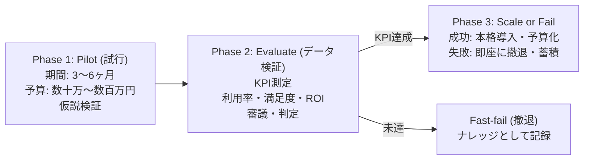

# PFU 政策実験フレームワーク (小さく試す・撤退の規律)

> 🔗 **議員活動との接続**: まちづくり原則「どうすればできるか」「人を責めず仕組みを改善」の実装手法 → [[civic/election-2026/candidates/hijikuro-koji/city-vision-principles|まちづくり理念と5つの行動原則]] / [[civic/concepts/public-private-partnership|官民連携・PPP]]

Policy Fast-fail & Upgrade (PFU) は、不確実性の高い自治体経営において「最初から巨額予算を組まず、小さく試し、データで検証し、ダメなら素早く撤退する」ための政策規律フレームワークです。

## 🔄 PFUの3フェーズサイクル

---

## 🎯 宇土市での適用候補テーマ

1. **AIオンデマンド交通の試行**:
   - 最初から市全域で路線バスを廃止するのではなく、まず走潟・網田地区の特定エリアで3ヶ月間実験運行。
2. **小中学校の余裕教室複合化**:
   - 全校一括改修ではなく、1校で公民館サークル活動の利用実態を検証。
3. **行政窓口のオンライン・生成AI案内**:
   - 庁内一部課で試験導入し、職員の残業削減時間と市民待ち時間を定量評価。

---

## 💡 議会・政策判断のポイント
> [!tip] 議員・政策担当者のアクション
> - 「失敗＝悪」とする減点主義の議会追及を改め、「小さく失敗して傷口を広げなかったこと（撤退の勇気）」を正当に評価する文化を議会主導で醸成すること。

---
## 関連ノート
- [[スマートシュリンク戦略ビジョン_5大政策ピラー]]
- [[行政DXと窓口・業務改革]]
- [[施策台帳と政策ROI算定基準]]
- [[04_政策・未来シナリオ_MOC]]
