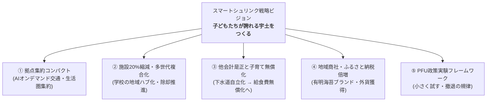

# スマートシュリンク戦略ビジョン：5大政策ピラー

「人口減少＝衰退」ではなく、「賢く再編し、市民1人あたりの豊かさと幸福度を高める（スマートシュリンク）」ための5大政策ピラーです。

## 🏛️ 5大政策ピラーの全体像

---

## 📌 ピラー詳細

### ピラー①：拠点集約コンパクト＋AIオンデマンド交通
- 居住を強制移転させるのではなく、行政機能・医療・商業を集約した「生活拠点」を形成。
- 郊外集落からはAIオンデマンド配車交通でワンコイン移動できるモビリティ網を確立。

### ピラー②：施設延床面積20%縮減・多世代複合化
- [[公共施設431億円問題と年間15.5億円ギャップ]] の解決。
- 余裕教室を活用した小中学校への公民館・学童・避難機能の集約。

### ピラー③：他会計是正による子育て・給食費無償化
- 下水道事業の自立化により浮いた一般財源（年間約1.5億円）を、小中学校の給食費無償化に直結させる財源シフト。

### ピラー④：地域商社とふるさと納税倍増（稼ぐ力）
- 縮小均衡から脱却するため、宇土の特産品（有明海苔・網田ネーブル等）の高付加価値化とふるさと納税寄附額（目標10億円）の達成。

### ピラー⑤：PFU政策実験（小さく試し、撤退する規律）
- 大規模予算を一気に投じるのではなく、小さく実験してデータで検証するアジャイル行政。詳細は [[PFU_政策実験フレームワーク (小さく試す・撤退の規律)]] を参照。

---

## 💡 議会・政策判断のポイント
> [!tip] 議員・政策担当者のアクション
> - 5つのピラーをバラバラに議論せず、「インフラ削減で浮かせた財源を、子育てと稼ぐ力に再投資する」という一本のストーリーとして議会論戦を展開すること。

---
## 関連ノート
- [[2040未来予測センター_時間軸と判断期限]]
- [[PFU_政策実験フレームワーク (小さく試す・撤退の規律)]]
- [[地域商社と外貨獲得戦略 (有明海苔・ふるさと納税)]]
- [[行政DXと窓口・業務改革]]
- [[04_政策・未来シナリオ_MOC]]
