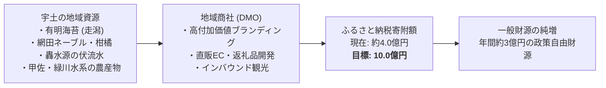

# 地域商社と外貨獲得戦略 (有明海苔・ふるさと納税)

> 🔗 **議員活動との接続**: 公約③「稼ぐ」の中核。地域商社・ふるさと納税の販路接続 → [[civic/election-2026/candidates/hijikuro-koji/five-challenges-content|5つの挑戦 肉付け]] / [[civic/themes/industrial-strategy|産業戦略・地域商社]]

地方交付税や市税の自然減が不可避となる中、宇土市の豊かな農水産物資源を活かして域外から新たな財源（外貨）を獲得するための「官民連携地域商社」と「ふるさと納税倍増戦略」です。

## 💰 自主財源創出のロードマップ

---

## 🌊 重点アクション：有明海苔のブランド再定義
- **課題**: 全国屈指の品質を誇りながら、問屋経由の一括出荷が多く「宇土産」としての認知度が低く買いたたかれている。
- **商社機能**:
  - 初摘み海苔のプレミアムパッケージ化
  - 都内有名料亭やオーガニック市場への直販ルート開拓
  - ふるさと納税のフラッグシップ返礼品化

---

## 💡 議会・政策判断のポイント
> [!tip] 議員・政策担当者のアクション
> - ふるさと納税のポータルサイト手数料や返礼品調達コスト（経費率約50%）を厳密に把握し、中間マージンを地元事業者に還元する地域商社モデルへの転換を提言すること。

---
## 関連ノート
- [[スマートシュリンク戦略ビジョン_5大政策ピラー]]
- [[宇土市_財政構造診断_総括]]
- [[市内7地区カルテ_走潟地区 (漁業・海苔・コミュニティ)]]
- [[04_政策・未来シナリオ_MOC]]
