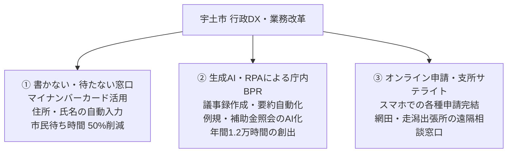

# 行政DXと窓口・業務改革

> 🔗 **議員活動との接続**: 公約④「動かす」・宇土OSの実装論 → [[06_市政・議会/02_選挙2026/candidates/hijikuro-koji/uto-os-explained|宇土OSやさしい説明]] / [[06_市政・議会/themes/civic-engagement-dx|市民参加・行政DX]] / [[06_市政・議会/01_概念集/dx-strategy|DX戦略]]

生産年齢人口の激減と職員定年延長・人手不足の時代に対応し、行政サービスの質を落とさずに業務量を削減する「書かない窓口」「AI・BPR導入」「組織再編」の具体策です。

## 💻 行政DXの3本柱

---

## ⏱️ 期待される削減効果と人的リソースシフト
- **定型業務時間の削減**: RPA・AI導入により、庁内全体で年間約12,000時間のルーティン作業を削減。
- **創出した時間の再配分**: 削減した時間を、市民相談、生活困窮者支援、地域RMO伴走、政策立案などの「対人・共創業務」へシフト。

---

## 💡 議会・政策判断のポイント
> [!tip] 議員・政策担当者のアクション
> - DXを単なる「システムの購入」で終わらせず、不要な申請書類の廃止や押印廃止など、根本的な業務見直し（BPR）が伴っているかを追及すること。

---
## 関連ノート
- [[スマートシュリンク戦略ビジョン_5大政策ピラー]]
- [[PFU_政策実験フレームワーク (小さく試す・撤退の規律)]]
- [[RMO_地域運営組織と住民主体自治モデル]]
- [[04_政策・未来シナリオ_MOC]]
