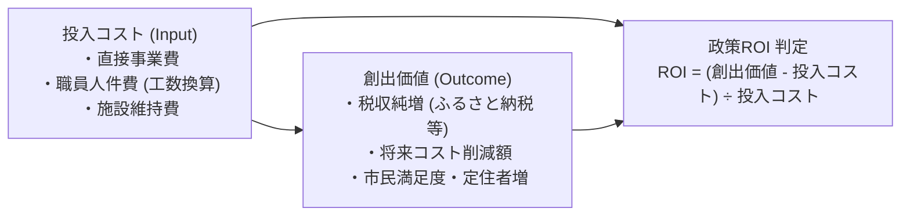

# 施策台帳と政策ROI算定基準

行政が行う補助金・イベント・インフラ投資などの各施策について、「事業費をいくら使ったか（Input）」ではなく、「市民にどのような価値や成果がもたらされたか（Outcome）」を定量評価するための政策ROI（費用対効果）算定基準です。

## 📐 政策ROIの算定ロジック

---

## 📊 事業類型別のROI判定基準

| 事業区分 | 目標ROI | 判定基準・成果指標 | 不採択・見直しライン |
| :--- | :---: | :--- | :--- |
| **産業振興・外貨獲得** | **> 150%** | ふるさと納税寄附額、地元事業者売上増 | 投入額を下回る増収（ROI < 0%） |
| **インフラ長寿命化** | **> 120%** | 事後保全（全壊更新）との差額コスト削減 | 予防保全による延命効果が薄い施設 |
| **子育て・定住促進** | **> 100%** | 若年層転入超過数、出生率維持 | 近隣自治体への流出継続 |
| **文化・イベント振興** | 定性評価 | 参加者満足度、地域ボランティア参画率 | 参加者が固定化し年々減少 |

---

## 💡 議会・政策判断のポイント
> [!tip] 議員・政策担当者のアクション
> - 決算付属説明書における事務事業評価シートを精査し、政策ROIがマイナスの事業やサンセット期限を過ぎた補助金を洗い出し、廃止・統合を強く促すこと。

---
## 関連ノート
- [[市議会_重要論点トラッカーと一般質問逆引き]]
- [[PFU_政策実験フレームワーク (小さく試す・撤退の規律)]]
- [[スマートシュリンク戦略ビジョン_5大政策ピラー]]
- [[05_市議会論点・監査検証_MOC]]
