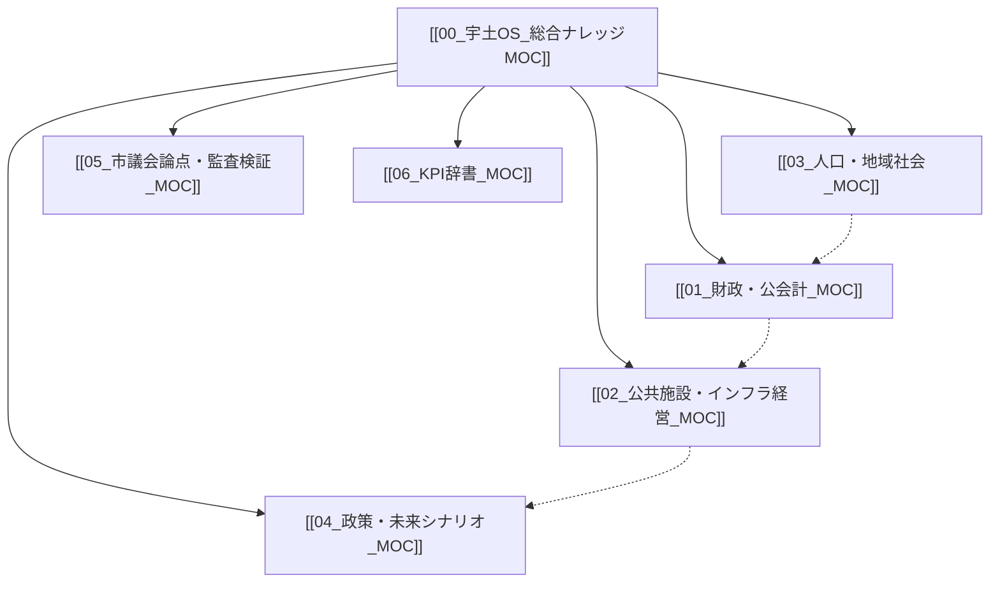

# 宇土OS 総合ナレッジ MOC (Map of Content)

> [!summary] 宇土OSの基本理念
> **「子どもたちが誇れる宇土をつくる」**
> 人口減少と施設更新の重複期において、「我慢の縮小」ではなく「賢い再編（スマートシュリンク）」を選び取り、未来に豊かな暮らしをつなぐためのオープンな政策プラットフォーム。

---

## 📌 分野別 MOC ナビゲーション

### 1. 財政・公会計深層分析
* **ハブノート**: [[01_財政・公会計_MOC]]
* **コアトピック**:
  * [[宇土市_財政構造診断_総括]] - 固定費率94.2%の構造と財政硬直化の深層
  * [[決算カード9か年推移分析 (H28-R6)]] - 熊本地震復興から通常財政への9か年軌跡
  * [[公債費償還カーブと復旧債ピーク分析]] - 借金返済のピークアウト（R9安全圏復帰）
  * [[基金耐久力と積立・取崩し戦略]] - 財政調整基金35.6億円の安全性と取崩し許容度
  * [[他会計繰出金・公費補填の実態]] - 一般会計から年間16.5億円（世帯10.3万円）の繰出
  * [[健全化判断比率と資金不足比率の推移 (R7審査)]] - 早期健全化基準に対する安全性

### 2. 公共施設・インフラ経営
* **ハブノート**: [[02_公共施設・インフラ経営_MOC]]
* **コアトピック**:
  * [[公共施設431億円問題と年間15.5億円ギャップ]] - 今後40年の更新費用と財源不足
  * [[公共施設用途別老朽度と集約・複合化方針]] - 学校43%と集会・スポーツ施設の再編
  * [[上水道事業会計_本業赤字と逆ザヤ分析 (R7決算)]] - 給水原価割れ▲6.22円/m³と有収率84.5%
  * [[下水道事業会計_年間4億円補填と独立採算の危機 (R7決算)]] - 経費回収率62.1%と一般会計負担
  * [[上下水道40年更新需要と料金改定ロードマップ]] - 老朽管路更新ピークと料金改定試算

### 3. 人口動態・地域社会・地区カルテ
* **ハブノート**: [[03_人口・地域社会_MOC]]
* **コアトピック**:
  * [[宇土市_人口動態と将来推計 (2025-2050)]] - 3.6万人から2.7万人への減少と少子高齢化
  * **市内7地区カルテ**:
    * [[市内7地区カルテ_宇土地区 (中心市街地・生活拠点)]]
    * [[市内7地区カルテ_花園地区 (学校・住宅・田園)]]
    * [[市内7地区カルテ_轟地区 (名水・歴史・コミュニティ)]]
    * [[市内7地区カルテ_緑川地区 (農地・河川・防災)]]
    * [[市内7地区カルテ_網津地区 (干拓・農業・高齢化)]]
    * [[市内7地区カルテ_網田地区 (沿岸・観光・医療交通)]]
    * [[市内7地区カルテ_走潟地区 (漁業・海苔・コミュニティ)]]
  * [[RMO_地域運営組織と住民主体自治モデル]] - 拠点集約と住民自治の共創
  * [[福祉・子育て・教育_くらしのセーフティネット]] - 扶助費増加と子育て環境の維持

### 4. 政策提言・未来シナリオ
* **ハブノート**: [[04_政策・未来シナリオ_MOC]]
* **コアトピック**:
  * [[2040未来予測センター_時間軸と判断期限]] - 人口・インフラ・財政が交錯するデッドライン
  * [[スマートシュリンク戦略ビジョン_5大政策ピラー]] - 「小さくても豊かな宇土」への処方箋
  * [[PFU_政策実験フレームワーク (小さく試す・撤退の規律)]] - 小さく試し、データで検証する
  * [[地域商社と外貨獲得戦略 (有明海苔・ふるさと納税)]] - 縮小均衡を脱する稼ぐ力
  * [[行政DXと窓口・業務改革]] - 書かない窓口と職員数適正化

### 5. 市議会論点・監査検証
* **ハブノート**: [[05_市議会論点・監査検証_MOC]]
* **コアトピック**:
  * [[市議会_重要論点トラッカーと一般質問逆引き]] - 議会審議における論点マップ
  * [[R8第3回定例会_補正予算審議と決算審査ポイント]] - 議案・補正・決算審査のチェック項目
  * [[施策台帳と政策ROI算定基準]] - コスト対効果の検証基準

### 6. KPI辞書・用語ハンドブック
* **ハブノート**: [[06_KPI辞書_MOC]]
* **コアトピック**:
  * [[自治体経営KPIハンドブック_定義と市民翻訳]] - 専門用語を市民目線で読み解く辞書
